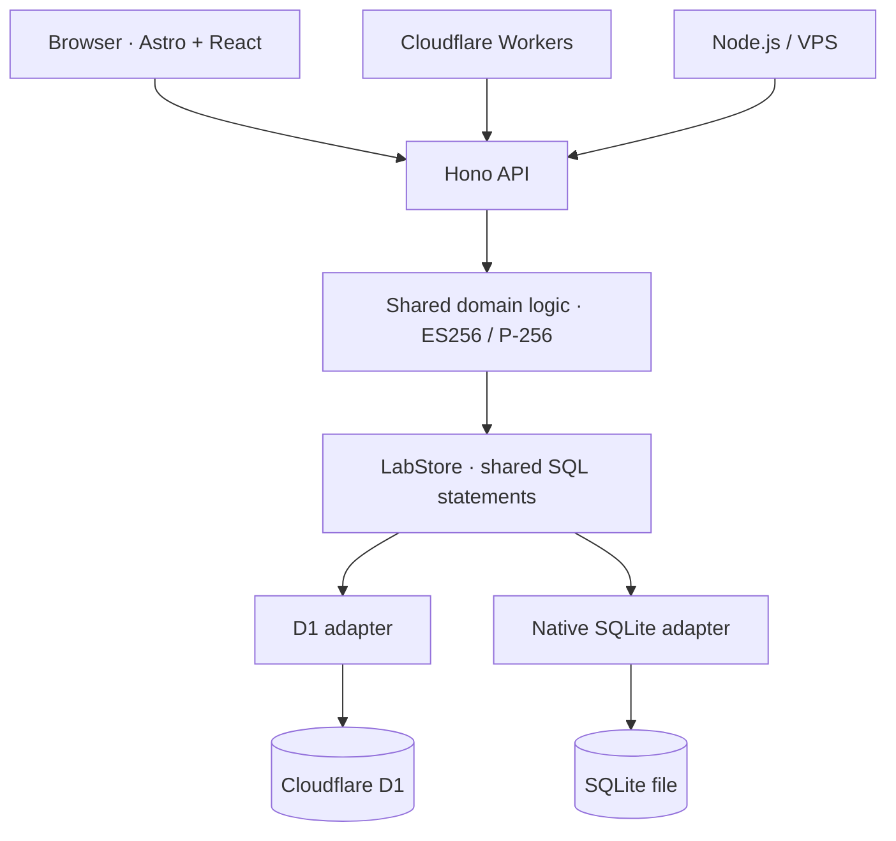
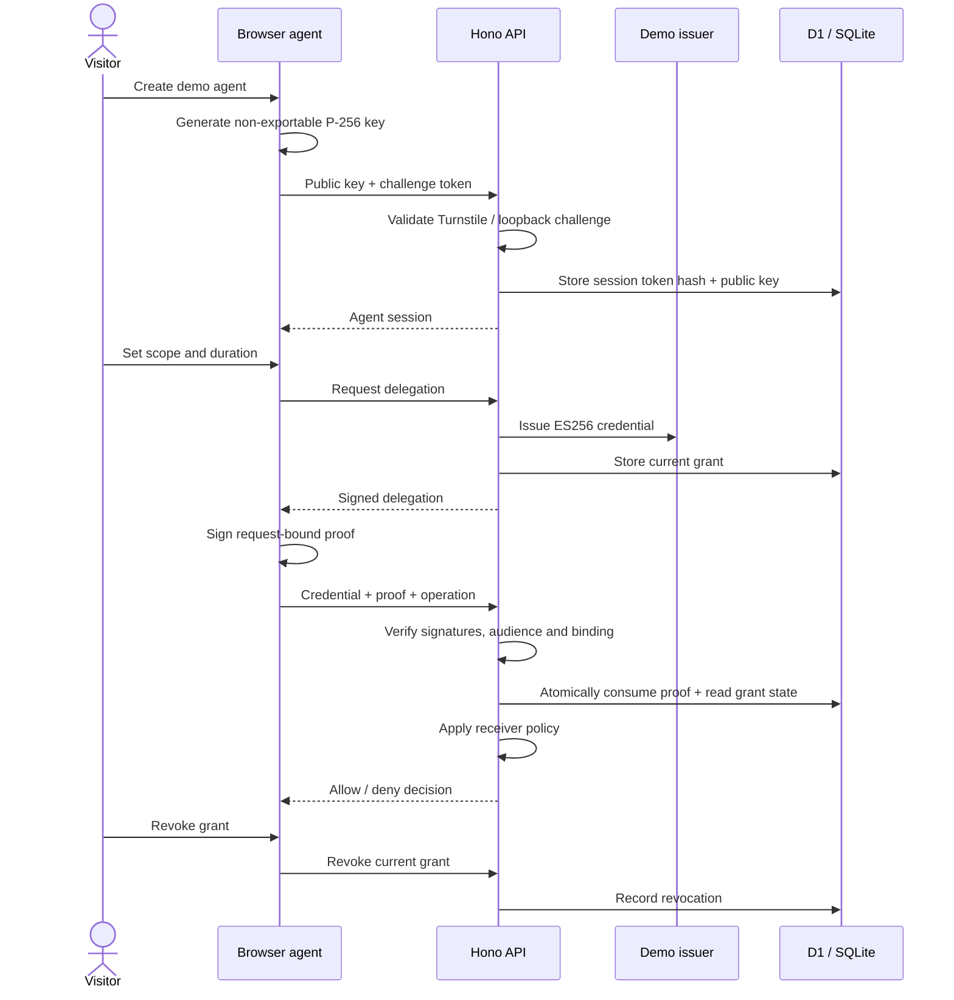

<p align="center"><a href="https://identity.rounver.com/"></a></p>
<h1 align="center">Regidi PoC</h1>
<p align="center">Cryptographic identity · Scoped delegation · Verifiable authorization for AI agents</p>
<p align="center">
  
  
  
  
</p>
<p align="center"><strong>English</strong> · <a href="docs/README.es.md">Español</a> · <a href="docs/README.pt.md">Português</a> · <a href="docs/README.de.md">Deutsch</a> · <a href="docs/README.fr.md">Français</a> · <a href="docs/README.it.md">Italiano</a> · <a href="docs/README.ja.md">日本語</a> · <a href="docs/README.hi.md">हिन्दी</a> · <a href="docs/README.ar.md">العربية</a></p>
<p align="center"><a href="https://rounver.com/"></a></p>

---

## About the project

Regidi PoC is an open-source research demonstration created by **Rounver Corp. / Rounver Research**. It explores **cryptographic AI agent identity**, **scoped human delegation**, and **receiver-side verification** using simulated operations. It is not the full Regidi-ID protocol or a certified production identity platform.

**Explore the official interactive lab:** https://identity.rounver.com/lab/ · **Regidi-ID overview:** https://rounver.com/regidi-id

## What it demonstrates

- **Browser-held P-256 keys.** The private signing key is generated as non-exportable and stays in the browser tab.
- **Signed delegation.** A demo issuer grants scoped ES256 credentials, constrained by service, operation, amount and duration.
- **Proof of possession.** Each request carries a signature bound to the credential, HTTP endpoint and request body.
- **Authorization decisions.** A simulated airline or bank independently applies its receiving policy.
- **Stateful security.** Atomic proof consumption, replay prevention, grant replacement, revocation and expiration.
- **Two compatible runtimes.** Node.js + native SQLite or Cloudflare Workers + D1, sharing the API, SQL and domain logic.

## Architecture



## End-to-end flow


## Quick start: Node.js + SQLite

Requires **Node.js 24**. Node + SQLite needs at least **24.6**; **24.22+** is recommended for the complete toolchain.

```bash
npm ci
(umask 077
  if [ ! -e .env ]; then
    cp .env.example .env
    printf "ISSUER_PRIVATE_JWK='%s'\n" "$(npm run --silent keygen)" >> .env
  fi
)
npm run dev
```

Open **http://127.0.0.1:8787/lab/**. No Cloudflare account is needed. The local challenge works only when `NODE_ENV=development`, `REGIDI_CHALLENGE=development`, and the listener is bound to `127.0.0.1`.

## Cloudflare Workers + D1 (optional)

```bash
npm ci
npm run db:local
npm run build:cloudflare
npm run check:cloudflare
npm test
```

For interactive local Worker mode, configure `.dev.vars` from `.dev.vars.example`, generate a separate issuer key, and configure a Turnstile widget authorized for the local hostname. Pass `PUBLIC_TURNSTILE_SITE_KEY` at build time and the matching `REGIDI_PUBLIC_ORIGIN`. Then run `npm run dev:cloudflare`. Production deployments require explicit Worker, account, D1 and limiter settings; see `.env.example` and `cloudflare.config.ts`. The deployment preflight intentionally requires an existing target and does not provision infrastructure.

## Configuration reference

| Variable | Meaning |
|---|---|
| `REGIDI_HOST`, `REGIDI_PORT` | Node listener address and port (default `127.0.0.1:8787`) |
| `REGIDI_SQLITE_PATH` | Local SQLite file path (default `./regidi-lab.sqlite`) |
| `NODE_ENV`, `REGIDI_CHALLENGE` | Explicit loopback development mode; otherwise Turnstile |
| `REGIDI_PUBLIC_ORIGIN` | Public HTTPS origin for hosted installations and proof checks |
| `PUBLIC_TURNSTILE_SITE_KEY` | Browser widget key, supplied at build time |
| `TURNSTILE_SECRET` | Server-side Turnstile secret |
| `ISSUER_PRIVATE_JWK` | Freshly generated private P-256 issuer JWK; keep confidential |
| `REGIDI_ISSUER`, `REGIDI_AIR_AUDIENCE`, `REGIDI_BANK_AUDIENCE` | Optional issuer/audience identifiers |
| `CLOUDFLARE_ACCOUNT_ID`, `REGIDI_WORKER_NAME`, `REGIDI_D1_NAME`, `REGIDI_D1_ID`, `REGIDI_RATE_NAMESPACE` | Explicit Cloudflare deployment targets |

## Checks

```bash
npm run check
npm run check:cloudflare
npm run test:node
npm test
npm run audit:deps
```

`npm test` runs both builds and the automated test suites. There are no required GitHub Actions or automatic publishing pipelines.

## Deployment and security limitations

> **Security scope:** This is an educational proof of concept. It uses fictional identities and simulated banking/airline operations, does not perform KYC/KYB, and must not be treated as a certified identity service. Public instances require HTTPS and Cloudflare Turnstile. Local loopback development uses an explicitly enabled single-use challenge.

- **Reverse proxies:** The Node adapter derives IP budgets from the TCP peer, not forwarded IP headers. Clients behind one proxy may share a rate limit and receive HTTP 429.
- **Hosted Node:** Configure HTTPS at the reverse proxy, `REGIDI_PUBLIC_ORIGIN`, production Turnstile credentials and a persistent writable SQLite path.
- **Cryptography:** Issuer keys are server-side. Do not commit `.env`, `.dev.vars`, database files or generated private JWKs.
- **Verification:** Real hosted Turnstile integration requires operator-specific validation. Local automated suites mock Siteverify.

## Policies for independent deployments

The included privacy policy, terms and security policy apply to the **official installation operated by Rounver Corp.** Independent operators must adapt them to their own identity, infrastructure, data processing and legal duties.

## Maintenance and contributions

The original software and technical documentation are licensed under [MIT](LICENSE). Rounver Corp. exclusively maintains the official upstream project. External pull requests are **not accepted**; [Issues](https://github.com/rounverr/regidi-poc/issues) may be used to report defects. MIT permits third-party forks and reuse under its terms, without requiring upstream to accept changes.

The original logos and graphics may be redistributed **with this PoC and attribution**, subject to [third-party and brand notices](THIRD_PARTY_NOTICES.md). Font and dependency licenses remain applicable.

## Credits

Created and maintained by **Rounver Corp.** through **Rounver Research**. [Rounver](https://rounver.com/) · [Regidi-ID](https://rounver.com/regidi-id) · [Official Lab](https://identity.rounver.com/).

**Autora:** Sil R. Galeano
