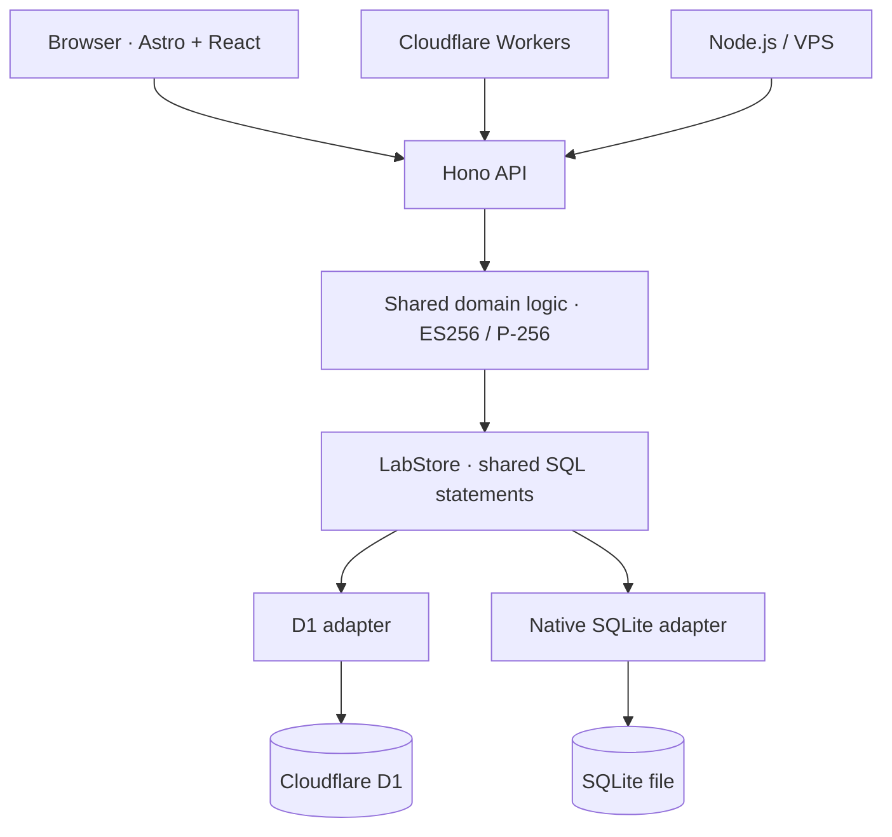
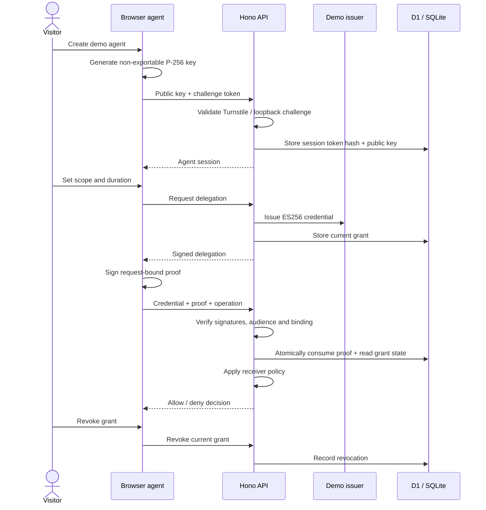

<p align="center"><a href="https://identity.rounver.com/"></a></p>
<h1 align="center">Regidi PoC</h1>
<p align="center">هوية مشفّرة · تفويض محدود · صلاحيات قابلة للتحقق لوكلاء الذكاء الاصطناعي</p>
<p align="center">
  
  
  
  
</p>
<p align="center"><a href="../README.md">English</a> · <a href="README.es.md">Español</a> · <a href="README.pt.md">Português</a> · <a href="README.de.md">Deutsch</a> · <a href="README.fr.md">Français</a> · <a href="README.it.md">Italiano</a> · <a href="README.ja.md">日本語</a> · <a href="README.hi.md">हिन्दी</a> · <strong>العربية</strong></p>
<p align="center"><a href="https://rounver.com/"></a></p>

---

## حول المشروع

Regidi PoC عرض بحثي مفتوح المصدر من **Rounver Corp. / Rounver Research**. يستكشف **الهوية المشفّرة لوكلاء الذكاء الاصطناعي** و**التفويض البشري محدود النطاق** و**التحقق لدى الجهة المستقبِلة** باستخدام عمليات محاكاة. لا يمثل بروتوكول Regidi-ID الكامل ولا منصة هوية معتمدة للإنتاج.

**المختبر التفاعلي الرسمي:** https://identity.rounver.com/lab/ · **نظرة عامة على Regidi-ID:** https://rounver.com/regidi-id

## ما الذي يوضحه؟

- **مفاتيح P-256 في المتصفح.** يُنشأ مفتاح التوقيع الخاص بحيث لا يمكن تصديره ويبقى داخل علامة تبويب المتصفح.
- **تفويض موقّع.** يُصدر مُصدِر تجريبي بيانات اعتماد ES256 مقيّدة بالخدمة والعملية والمبلغ والمدة.
- **إثبات حيازة المفتاح.** يحمل كل طلب توقيعاً مرتبطاً ببيانات الاعتماد ونقطة نهاية HTTP ومحتوى الطلب.
- **قرارات التفويض.** تطبّق شركة طيران أو بنك محاكى سياساته المستقلة عند استقبال الطلب.
- **أمان مع حالة محفوظة.** استهلاك الإثباتات بشكل ذري، ومنع إعادة الاستخدام، واستبدال التفويض، والإلغاء، وانتهاء الصلاحية.
- **بيئتا تشغيل متوافقتان.** Node.js مع SQLite الأصلي أو Cloudflare Workers مع D1، مع مشاركة API واستعلامات SQL ومنطق المجال.

## البنية المعمارية



## التسلسل الكامل



## البدء السريع: Node.js + SQLite

يتطلب **Node.js 24**. تحتاج بيئة Node + SQLite إلى **24.6** على الأقل، ويُنصح باستخدام **24.22+** لتشغيل مجموعة الأدوات الكاملة.

```bash
npm ci
(umask 077
  if [ ! -e .env ]; then
    cp .env.example .env
    printf "ISSUER_PRIVATE_JWK='%s'\n" "$(npm run --silent keygen)" >> .env
  fi
)
npm run dev
```

افتح **http://127.0.0.1:8787/lab/**. لا تحتاج إلى حساب Cloudflare. يعمل التحدي المحلي فقط مع `NODE_ENV=development` و`REGIDI_CHALLENGE=development` وعند ربط الخادم بـ`127.0.0.1`.

## Cloudflare Workers + D1 (اختياري)

```bash
npm ci
npm run db:local
npm run build:cloudflare
npm run check:cloudflare
npm test
```

لتشغيل Worker محلياً، أنشئ `.dev.vars` انطلاقاً من `.dev.vars.example`، وولّد مفتاحاً مستقلاً للمُصدِر، واضبط أداة Turnstile مسموحاً لها باستخدام اسم المضيف المحلي. أدخل `PUBLIC_TURNSTILE_SITE_KEY` أثناء البناء واضبط `REGIDI_PUBLIC_ORIGIN` المطابق. ثم شغّل `npm run dev:cloudflare`. يتطلب النشر الإنتاجي قيماً صريحة لـWorker والحساب وD1 ومحدد المعدل؛ راجع `.env.example` و`cloudflare.config.ts`. يتحقق فحص ما قبل النشر من وجود الوجهة مسبقاً ولا ينشئ موارد البنية التحتية.

## مرجع الإعدادات

| المتغير | المعنى |
|---|---|
| `REGIDI_HOST`, `REGIDI_PORT` | عنوان ومنفذ خادم Node (الافتراضي `127.0.0.1:8787`) |
| `REGIDI_SQLITE_PATH` | مسار ملف SQLite المحلي (الافتراضي `./regidi-lab.sqlite`) |
| `NODE_ENV`, `REGIDI_CHALLENGE` | وضع تطوير loopback صريح؛ وإلا يُستخدم Turnstile |
| `REGIDI_PUBLIC_ORIGIN` | الأصل العام HTTPS للاستضافات والتحقق من الإثباتات |
| `PUBLIC_TURNSTILE_SITE_KEY` | المفتاح العام للأداة المحدد أثناء البناء |
| `TURNSTILE_SECRET` | سر Turnstile على الخادم |
| `ISSUER_PRIVATE_JWK` | مفتاح JWK خاص P-256 جديد للمُصدِر؛ يجب إبقاؤه سرياً |
| `REGIDI_ISSUER`, `REGIDI_AIR_AUDIENCE`, `REGIDI_BANK_AUDIENCE` | معرّفات اختيارية للمُصدِر والجمهور |
| `CLOUDFLARE_ACCOUNT_ID`, `REGIDI_WORKER_NAME`, `REGIDI_D1_NAME`, `REGIDI_D1_ID`, `REGIDI_RATE_NAMESPACE` | وجهات النشر الصريحة في Cloudflare |

## التحقق والاختبارات

```bash
npm run check
npm run check:cloudflare
npm run test:node
npm test
npm run audit:deps
```

يشغّل `npm test` عمليتي البناء ومجموعات الاختبارات الآلية. لا تُعد GitHub Actions أو مسارات النشر التلقائي شرطاً.

## النشر وحدود الأمان

> **نطاق الأمان:** هذا نموذج توضيحي تعليمي. يستخدم هويات خيالية وعمليات محاكاة للبنوك والطيران، ولا ينفذ إجراءات KYC/KYB، ولا ينبغي اعتباره خدمة هوية معتمدة. تتطلب النسخ العامة HTTPS وCloudflare Turnstile. ويستخدم التطوير المحلي تحدياً أحادي الاستخدام مفعّلاً صراحةً.

- **الوكلاء العكسيون:** يعتمد Node على عنوان نظير اتصال TCP لحساب حدود IP، لا على ترويسات إعادة التوجيه. قد يتشارك زوار خلف وكيل واحد الحد ويتلقون HTTP 429.
- **استضافة Node:** اضبط HTTPS على الوكيل و`REGIDI_PUBLIC_ORIGIN` وبيانات Turnstile الإنتاجية ومسار SQLite دائماً قابلاً للكتابة.
- **التشفير:** تبقى مفاتيح المُصدِر على الخادم. لا تُضف ملفات `.env` أو `.dev.vars` أو قواعد البيانات أو مفاتيح JWK الخاصة إلى المستودع.
- **التحقق:** تحتاج استضافة Turnstile الحقيقية إلى اختبار خاص بالمشغّل. تحاكي الاختبارات المحلية Siteverify.

## السياسات للنسخ المستقلة

تنطبق سياسات الخصوصية وشروط الاستخدام والأمان المرفقة على **التثبيت الرسمي الذي تديره Rounver Corp.** ويجب على المشغلين المستقلين تعديلها لتعكس هوية المشغّل والبنية التحتية ومعالجة البيانات والالتزامات القانونية.

## الصيانة والمساهمات

البرنامج الأصلي والوثائق التقنية مرخّصان بموجب [MIT](../LICENSE). تتولى Rounver Corp. وحدها صيانة المشروع الرسمي. **لا تُقبل طلبات السحب الخارجية**؛ ويمكن الإبلاغ عن الأخطاء عبر [Issues](https://github.com/rounverr/regidi-poc/issues). تسمح MIT بالنسخ المتفرعة وإعادة الاستخدام دون إلزام المشروع الرسمي بدمج التغييرات.

يمكن إعادة توزيع الشعارات والرسومات الأصلية **مع هذا النموذج ومع نسبتها إلى الجهة المالكة** وفق [إشعارات الأطراف الثالثة والعلامات التجارية](../THIRD_PARTY_NOTICES.md). تبقى تراخيص الخطوط والتبعيات سارية.

## الاعتمادات

أنشأته وتديره **Rounver Corp.** من خلال **Rounver Research**. [Rounver](https://rounver.com/) · [Regidi-ID](https://rounver.com/regidi-id) · [Official Lab](https://identity.rounver.com/).

**Autora:** Sil R. Galeano
