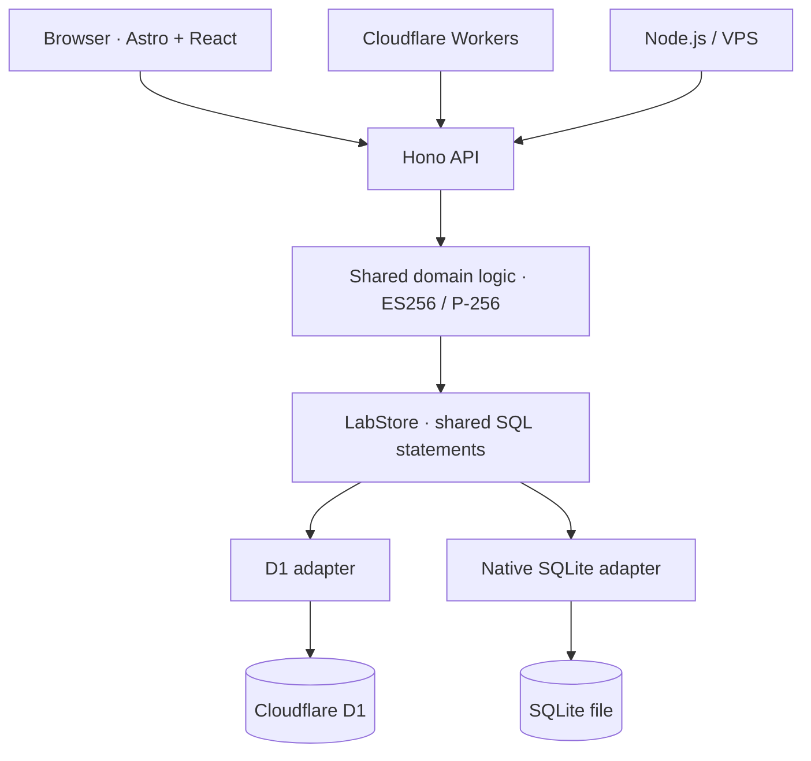
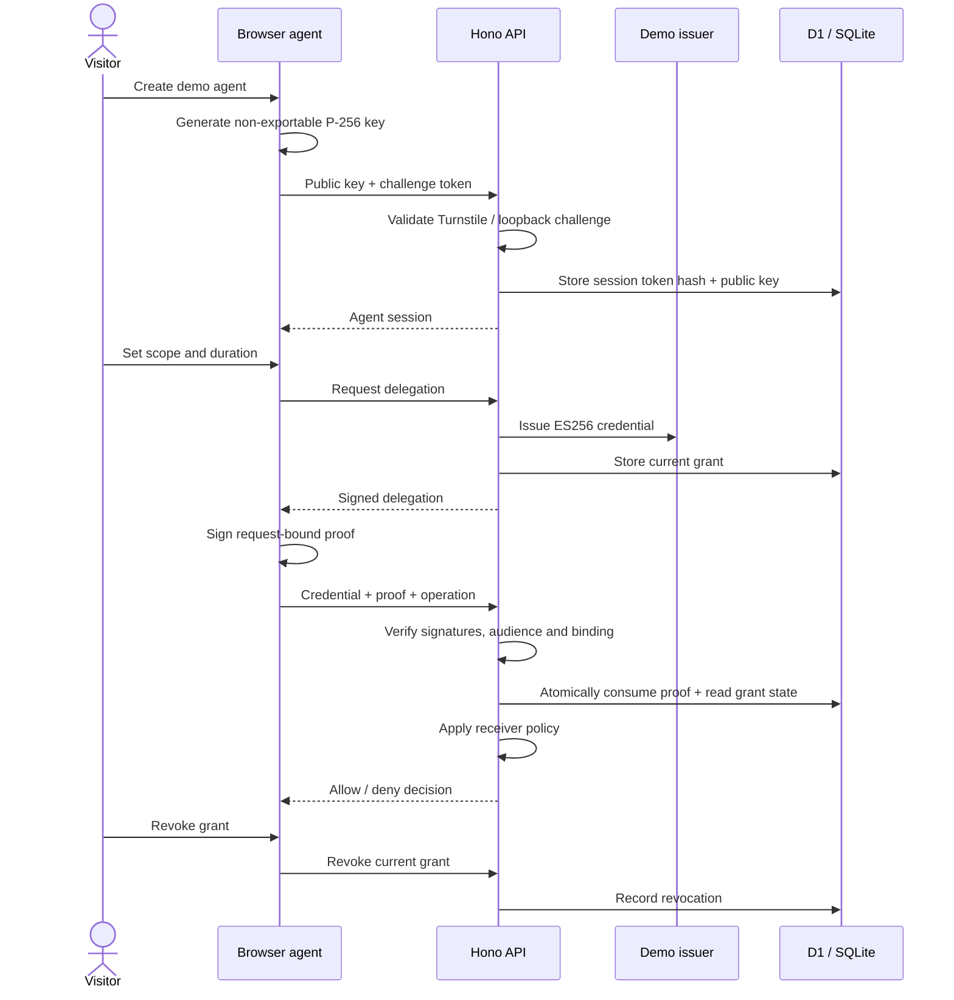

<p align="center"><a href="https://identity.rounver.com/"></a></p>
<h1 align="center">Regidi PoC</h1>
<p align="center">Kryptografische Identität · Eingeschränkte Delegation · Überprüfbare KI-Agenten-Autorisierung</p>
<p align="center">
  
  
  
  
</p>
<p align="center"><a href="../README.md">English</a> · <a href="README.es.md">Español</a> · <a href="README.pt.md">Português</a> · <strong>Deutsch</strong> · <a href="README.fr.md">Français</a> · <a href="README.it.md">Italiano</a> · <a href="README.ja.md">日本語</a> · <a href="README.hi.md">हिन्दी</a> · <a href="README.ar.md">العربية</a></p>
<p align="center"><a href="https://rounver.com/"></a></p>

---

## Über das Projekt

Regidi PoC ist ein Open-Source-Forschungsdemonstrator der **Rounver Corp. / Rounver Research**. Das Projekt veranschaulicht **kryptografische Identität von KI-Agenten**, **begrenzt delegierte menschliche Berechtigungen** und **Prüfungen durch empfangende Dienste** anhand simulierter Vorgänge. Es ist weder das vollständige Regidi-ID-Protokoll noch eine zertifizierte Identitätsplattform für den Produktivbetrieb.

**Offizielles interaktives Labor:** https://identity.rounver.com/lab/ · **Regidi-ID-Überblick:** https://rounver.com/regidi-id · **[Technisches White Paper (DOI)](https://doi.org/10.5281/zenodo.24469990)**

## Demonstrierte Funktionen

- **P-256-Schlüssel im Browser.** Der private Signaturschlüssel ist nicht exportierbar und bleibt im Browser-Tab.
- **Signierte Delegation.** Ein Demo-Aussteller erzeugt ES256-Zugangsnachweise mit Beschränkungen für Dienst, Vorgang, Betrag und Dauer.
- **Besitznachweis.** Jede Anfrage enthält eine Signatur, die an Nachweis, HTTP-Endpunkt und Anfragetext gebunden ist.
- **Autorisierungsentscheidung.** Eine simulierte Fluggesellschaft oder Bank wendet ihre eigene Empfangsrichtlinie an.
- **Zustandsbasierte Sicherheit.** Atomare Verwendung von Nachweisen, Replay-Schutz, Ersetzen von Berechtigungen, Widerruf und Ablauf.
- **Zwei kompatible Laufzeitumgebungen.** Node.js mit nativem SQLite oder Cloudflare Workers mit D1; API, SQL und Domänenlogik werden gemeinsam genutzt.

## Architektur



## Ablauf von Anfang bis Ende



## Schnellstart: Node.js + SQLite

Benötigt **Node.js 24**. Node + SQLite erfordert mindestens **24.6**; **24.22+** wird für die gesamte Toolchain empfohlen.

```bash
npm ci
(umask 077
  if [ ! -e .env ]; then
    cp .env.example .env
    printf "ISSUER_PRIVATE_JWK='%s'\n" "$(npm run --silent keygen)" >> .env
  fi
)
npm run dev
```

Öffne **http://127.0.0.1:8787/lab/**. Ein Cloudflare-Konto ist nicht erforderlich. Die lokale Challenge funktioniert nur mit `NODE_ENV=development`, `REGIDI_CHALLENGE=development` und einem Listener auf `127.0.0.1`.

## Cloudflare Workers + D1 (optional)

```bash
npm ci
npm run db:local
npm run build:cloudflare
npm run check:cloudflare
npm test
```

Für den lokalen Worker-Betrieb `.dev.vars` aus `.dev.vars.example` erstellen, einen separaten Ausstellerschlüssel erzeugen und ein Turnstile-Widget für den lokalen Host einrichten. `PUBLIC_TURNSTILE_SITE_KEY` beim Build und das passende `REGIDI_PUBLIC_ORIGIN` angeben. Danach `npm run dev:cloudflare` ausführen. Produktive Deployments benötigen explizite Worker-, Konto-, D1- und Limiter-Ziele; siehe `.env.example` und `cloudflare.config.ts`. Der Preflight verlangt bestehende Ressourcen und legt keine Infrastruktur an.

## Konfigurationsreferenz

| Variable | Bedeutung |
|---|---|
| `REGIDI_HOST`, `REGIDI_PORT` | Node-Listener-Adresse und Port (Standard `127.0.0.1:8787`) |
| `REGIDI_SQLITE_PATH` | Pfad zur SQLite-Datei (Standard `./regidi-lab.sqlite`) |
| `NODE_ENV`, `REGIDI_CHALLENGE` | Expliziter Loopback-Entwicklungsmodus, andernfalls Turnstile |
| `REGIDI_PUBLIC_ORIGIN` | Öffentlicher HTTPS-Ursprung für gehostete Installationen und Nachweisprüfung |
| `PUBLIC_TURNSTILE_SITE_KEY` | Öffentlicher Widget-Schlüssel beim Build |
| `TURNSTILE_SECRET` | Serverseitiges Turnstile-Geheimnis |
| `ISSUER_PRIVATE_JWK` | Neu erzeugter privater P-256-JWK des Ausstellers; vertraulich behandeln |
| `REGIDI_ISSUER`, `REGIDI_AIR_AUDIENCE`, `REGIDI_BANK_AUDIENCE` | Optionale Aussteller- und Audience-Kennungen |
| `CLOUDFLARE_ACCOUNT_ID`, `REGIDI_WORKER_NAME`, `REGIDI_D1_NAME`, `REGIDI_D1_ID`, `REGIDI_RATE_NAMESPACE` | Explizite Cloudflare-Bereitstellungsziele |

## Prüfungen

```bash
npm run check
npm run check:cloudflare
npm run test:node
npm test
npm run audit:deps
```

`npm test` führt beide Builds und die automatisierten Tests aus. GitHub Actions und automatische Veröffentlichungs-Pipelines sind nicht erforderlich.

## Bereitstellung und Sicherheitsgrenzen

> **Sicherheitsumfang:** Dies ist ein Lehr- und Forschungs-PoC. Es verwendet fiktive Identitäten und simulierte Bank- und Flugvorgänge, führt keine KYC/KYB-Prüfung durch und ist kein zertifizierter Identitätsdienst. Öffentliche Installationen benötigen HTTPS und Cloudflare Turnstile. Bei Loopback-Entwicklung wird eine ausdrücklich aktivierte Einmal-Challenge eingesetzt.

- **Reverse Proxys:** Node verwendet die TCP-Peer-Adresse für IP-Budgets und vertraut keinen weitergeleiteten IP-Headern. Mehrere Nutzer hinter einem Proxy können das Limit teilen und HTTP 429 erhalten.
- **Gehostetes Node:** HTTPS am Proxy, `REGIDI_PUBLIC_ORIGIN`, produktive Turnstile-Zugangsdaten und einen dauerhaft beschreibbaren SQLite-Pfad konfigurieren.
- **Kryptografie:** Ausstellerschlüssel bleiben serverseitig. `.env`, `.dev.vars`, Datenbanken und private JWKs niemals committen.
- **Verifikation:** Reales Turnstile muss für jede gehostete Installation separat geprüft werden. Lokale Tests simulieren Siteverify.

## Richtlinien für unabhängige Installationen

Die enthaltenen Datenschutz-, Nutzungs- und Sicherheitsrichtlinien gelten für die **offizielle Installation der Rounver Corp.** Unabhängige Betreiber müssen Betreiberangaben, Infrastruktur, Datenverarbeitung und rechtliche Pflichten anpassen.

## Wartung und Beiträge

Der ursprüngliche Quellcode und die technische Dokumentation stehen unter [MIT](../LICENSE). Rounver Corp. pflegt ausschließlich das offizielle Upstream-Projekt. **Externe Pull Requests werden nicht angenommen**; Fehler können über [Issues](https://github.com/rounverr/regidi-poc/issues) gemeldet werden. MIT erlaubt Forks und Wiederverwendung ohne Verpflichtung, Änderungen zu übernehmen.

Originale Logos und Grafiken dürfen **zusammen mit diesem PoC und mit Namensnennung** gemäß den [Drittanbieter- und Markenhinweisen](../THIRD_PARTY_NOTICES.md) weitergegeben werden. Schriften und Abhängigkeiten behalten ihre eigenen Lizenzen.

## Mitwirkende

Erstellt und gepflegt von **Rounver Corp.** im Rahmen von **Rounver Research**. [Rounver](https://rounver.com/) · [Regidi-ID](https://rounver.com/regidi-id) · [Official Lab](https://identity.rounver.com/).

**Autora:** Sil R. Galeano
