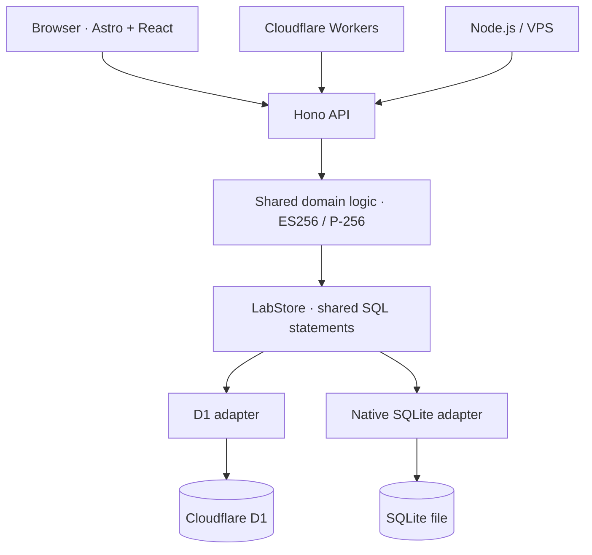
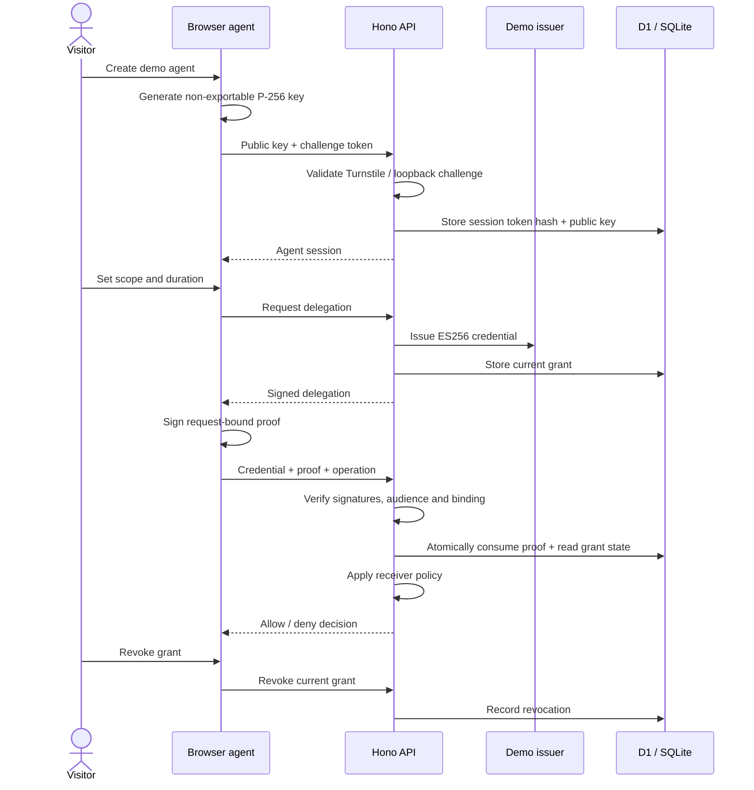

<p align="center"><a href="https://identity.rounver.com/"></a></p>
<h1 align="center">Regidi PoC</h1>
<p align="center">Identidad criptográfica · Delegación limitada · Autorización verificable para agentes de IA</p>
<p align="center">
  
  
  
  
</p>
<p align="center"><a href="../README.md">English</a> · <strong>Español</strong> · <a href="README.pt.md">Português</a> · <a href="README.de.md">Deutsch</a> · <a href="README.fr.md">Français</a> · <a href="README.it.md">Italiano</a> · <a href="README.ja.md">日本語</a> · <a href="README.hi.md">हिन्दी</a> · <a href="README.ar.md">العربية</a></p>
<p align="center"><a href="https://rounver.com/"></a></p>

---

## Acerca del proyecto

Regidi PoC es una demostración de investigación de código abierto creada por **Rounver Corp. / Rounver Research**. Explora la **identidad criptográfica de agentes de IA**, la **delegación humana limitada** y la **verificación por parte del receptor** mediante operaciones simuladas. No representa la implementación completa del protocolo Regidi-ID ni una plataforma de identidad productiva certificada.

**Laboratorio interactivo oficial:** https://identity.rounver.com/lab/ · **Descripción general de Regidi-ID:** https://rounver.com/regidi-id

## Qué demuestra

- **Claves P-256 en el navegador.** La clave privada de firma se genera como una clave no exportable y permanece en la pestaña.
- **Delegación firmada.** Un emisor de demostración entrega credenciales ES256 restringidas por servicio, operación, monto y duración.
- **Prueba de posesión.** Cada solicitud lleva una firma vinculada a la credencial, el punto de acceso HTTP y el cuerpo de la solicitud.
- **Decisiones de autorización.** Una aerolínea o un banco simulados aplican independientemente sus políticas de recepción.
- **Seguridad con estado.** Consumo atómico de pruebas, prevención de reutilización de pruebas, reemplazo de delegaciones, revocación y expiración.
- **Dos entornos de ejecución compatibles.** Node.js con SQLite nativo o Cloudflare Workers con D1, que comparten API, SQL y lógica de dominio.

## Arquitectura



## Flujo completo



## Inicio rápido: Node.js + SQLite

Requiere **Node.js 24**. Node + SQLite necesita al menos **24.6** y se recomienda **24.22+** para todas las herramientas.

```bash
npm ci
(umask 077
  if [ ! -e .env ]; then
    cp .env.example .env
    printf "ISSUER_PRIVATE_JWK='%s'\n" "$(npm run --silent keygen)" >> .env
  fi
)
npm run dev
```

Abra **http://127.0.0.1:8787/lab/**. No es necesario disponer de una cuenta de Cloudflare. El desafío local solo funciona con `NODE_ENV=development`, `REGIDI_CHALLENGE=development` y el servidor enlazado a `127.0.0.1`.

## Cloudflare Workers + D1 (opcional)

```bash
npm ci
npm run db:local
npm run build:cloudflare
npm run check:cloudflare
npm test
```

Para ejecutar Workers localmente, configure `.dev.vars` a partir de `.dev.vars.example`, genere una clave nueva para el emisor y configure un componente Turnstile autorizado para el nombre de host local. Proporcione `PUBLIC_TURNSTILE_SITE_KEY` durante el proceso de compilación y el `REGIDI_PUBLIC_ORIGIN` correspondiente. Después, ejecute `npm run dev:cloudflare`. Los despliegues productivos requieren identificadores explícitos de Worker, cuenta, D1 y limitador; consulte `.env.example` y `cloudflare.config.ts`. La verificación previa al despliegue exige un destino existente y no aprovisiona infraestructura.

## Referencia de configuración

| Variable | Significado |
|---|---|
| `REGIDI_HOST`, `REGIDI_PORT` | Dirección y puerto de Node (predeterminado `127.0.0.1:8787`) |
| `REGIDI_SQLITE_PATH` | Ruta del archivo SQLite local (predeterminada `./regidi-lab.sqlite`) |
| `NODE_ENV`, `REGIDI_CHALLENGE` | Modo de desarrollo local explícito; de lo contrario, Turnstile |
| `REGIDI_PUBLIC_ORIGIN` | Origen HTTPS público para instalaciones alojadas y verificación de pruebas |
| `PUBLIC_TURNSTILE_SITE_KEY` | Clave pública del componente Turnstile, configurada durante el proceso de compilación |
| `TURNSTILE_SECRET` | Secreto de Turnstile del servidor |
| `ISSUER_PRIVATE_JWK` | Clave JWK privada P-256 del emisor, generada para la instalación; mantenerla confidencial |
| `REGIDI_ISSUER`, `REGIDI_AIR_AUDIENCE`, `REGIDI_BANK_AUDIENCE` | Identificadores opcionales de emisor y audiencias |
| `CLOUDFLARE_ACCOUNT_ID`, `REGIDI_WORKER_NAME`, `REGIDI_D1_NAME`, `REGIDI_D1_ID`, `REGIDI_RATE_NAMESPACE` | Destinos explícitos del despliegue Cloudflare |

## Verificaciones

```bash
npm run check
npm run check:cloudflare
npm run test:node
npm test
npm run audit:deps
```

`npm test` ejecuta ambos procesos de compilación y los conjuntos de pruebas automatizadas. No se requieren GitHub Actions ni procesos automáticos de publicación.

## Despliegue y limitaciones de seguridad

> **Alcance de seguridad:** Este es un PoC educativo. Utiliza identidades ficticias y operaciones bancarias y aéreas simuladas, no realiza KYC/KYB y no debe tratarse como un servicio de identidad certificado. Las instalaciones públicas requieren HTTPS y Cloudflare Turnstile. El desarrollo en la interfaz de retorno local utiliza un mecanismo de desafío de un solo uso habilitado expresamente.

- **Servidores proxy inversos:** Node calcula los límites por IP a partir de la conexión TCP, no de cabeceras de reenvío. Varios usuarios detrás de un mismo servidor proxy pueden compartir el límite y recibir HTTP 429.
- **Node alojado:** Configure HTTPS en el servidor proxy, `REGIDI_PUBLIC_ORIGIN`, credenciales Turnstile productivas y una ruta SQLite persistente con permisos de escritura.
- **Criptografía:** Las claves del emisor permanecen en el servidor. No incluya `.env`, `.dev.vars`, archivos de base de datos ni claves JWK privadas generadas.
- **Verificación:** Turnstile real en instalaciones públicas requiere validación específica del operador. Las pruebas locales simulan Siteverify.

## Políticas para instalaciones independientes

Las políticas de privacidad, condiciones de uso y seguridad incluidas corresponden a la **instalación oficial operada por Rounver Corp.** Los operadores independientes deben adaptarlas a su identidad, infraestructura, tratamiento de datos y obligaciones legales.

## Mantenimiento y contribuciones

El software original y su documentación técnica se distribuyen bajo [MIT](../LICENSE). Rounver Corp. mantiene exclusivamente el proyecto oficial. **No se aceptan solicitudes de incorporación de cambios (pull requests) de terceros**; es posible informar sobre errores mediante [Issues](https://github.com/rounverr/regidi-poc/issues). MIT permite bifurcaciones del repositorio (forks) y la reutilización según sus términos, sin obligar al proyecto oficial a incorporar cambios.

Los logos y gráficos originales pueden redistribuirse **junto con este PoC y con atribución**, según los [avisos de terceros y marcas](../THIRD_PARTY_NOTICES.md). Se mantienen las licencias correspondientes a las fuentes y dependencias.

## Créditos

Creado y mantenido por **Rounver Corp.** mediante **Rounver Research**. [Rounver](https://rounver.com/) · [Regidi-ID](https://rounver.com/regidi-id) · [Official Lab](https://identity.rounver.com/).

**Autora:** Sil R. Galeano
