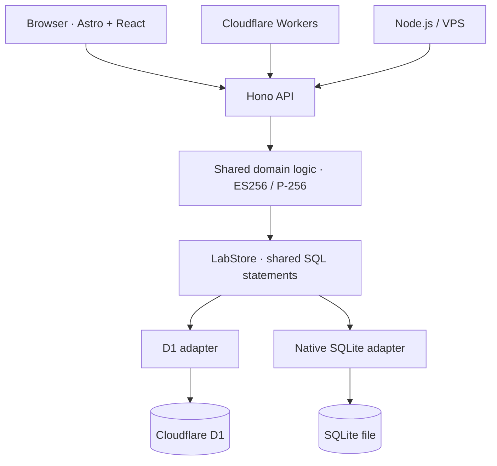
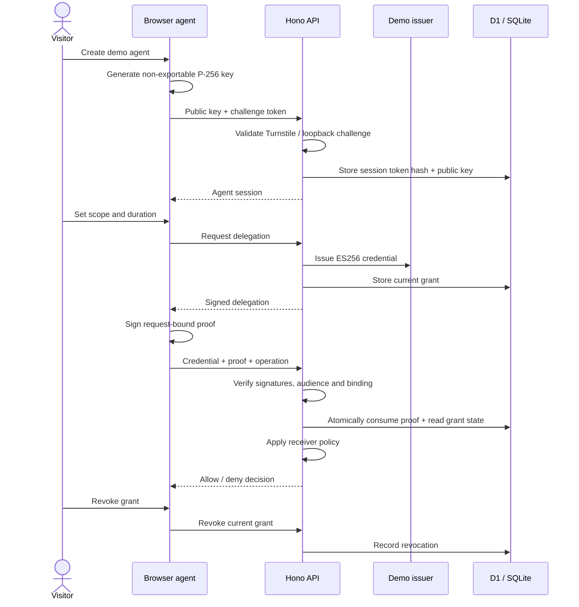

<p align="center"><a href="https://identity.rounver.com/"></a></p>
<h1 align="center">Regidi PoC</h1>
<p align="center">Identité cryptographique · Délégation limitée · Autorisation vérifiable des agents IA</p>
<p align="center">
  
  
  
  
</p>
<p align="center"><a href="../README.md">English</a> · <a href="README.es.md">Español</a> · <a href="README.pt.md">Português</a> · <a href="README.de.md">Deutsch</a> · <strong>Français</strong> · <a href="README.it.md">Italiano</a> · <a href="README.ja.md">日本語</a> · <a href="README.hi.md">हिन्दी</a> · <a href="README.ar.md">العربية</a></p>
<p align="center"><a href="https://rounver.com/"></a></p>

---

## Présentation du projet

Regidi PoC est une démonstration de recherche open source créée par **Rounver Corp. / Rounver Research**. Elle explore **l’identité cryptographique des agents IA**, la **délégation humaine à portée limitée** et la **vérification côté destinataire** à travers des opérations simulées. Il ne s’agit ni du protocole Regidi-ID complet ni d’une plateforme d’identité certifiée pour la production.

**Laboratoire interactif officiel :** https://identity.rounver.com/lab/ · **Présentation de Regidi-ID :** https://rounver.com/regidi-id · **[Livre blanc technique (DOI)](https://doi.org/10.5281/zenodo.24469990)**

## Ce que démontre le projet

- **Clés P-256 dans le navigateur.** La clé privée de signature est créée comme non exportable et reste dans l’onglet du navigateur.
- **Délégation signée.** Un émetteur de démonstration délivre des justificatifs ES256 limités par service, opération, montant et durée.
- **Preuve de possession.** Chaque requête comporte une signature liée au justificatif, au point d’accès HTTP et au corps de la requête.
- **Décisions d’autorisation.** Une compagnie aérienne ou une banque simulée applique indépendamment ses règles de réception.
- **Sécurité avec état.** Consommation atomique des preuves, prévention du rejeu, remplacement des délégations, révocation et expiration.
- **Deux environnements compatibles.** Node.js avec SQLite natif ou Cloudflare Workers avec D1, partageant API, SQL et logique métier.

## Architecture



## Déroulement complet



## Démarrage rapide : Node.js + SQLite

Nécessite **Node.js 24**. Node + SQLite requiert au moins la version **24.6** ; la version **24.22+** est recommandée pour l’ensemble des outils.

```bash
npm ci
(umask 077
  if [ ! -e .env ]; then
    cp .env.example .env
    printf "ISSUER_PRIVATE_JWK='%s'\n" "$(npm run --silent keygen)" >> .env
  fi
)
npm run dev
```

Ouvrez **http://127.0.0.1:8787/lab/**. Aucun compte Cloudflare n’est nécessaire. Le défi local ne fonctionne qu’avec `NODE_ENV=development`, `REGIDI_CHALLENGE=development` et une écoute sur `127.0.0.1`.

## Cloudflare Workers + D1 (facultatif)

```bash
npm ci
npm run db:local
npm run build:cloudflare
npm run check:cloudflare
npm test
```

Pour utiliser Workers localement, créez `.dev.vars` depuis `.dev.vars.example`, générez une clé d’émetteur distincte et configurez un widget Turnstile autorisé pour le nom d’hôte local. Fournissez `PUBLIC_TURNSTILE_SITE_KEY` au build et le `REGIDI_PUBLIC_ORIGIN` correspondant. Lancez ensuite `npm run dev:cloudflare`. Les déploiements en production exigent des cibles explicites Worker, compte, D1 et limiteur ; voir `.env.example` et `cloudflare.config.ts`. Le contrôle préalable exige des ressources existantes et ne crée pas d’infrastructure.

## Référence de configuration

| Variable | Description |
|---|---|
| `REGIDI_HOST`, `REGIDI_PORT` | Adresse et port du serveur Node (défaut `127.0.0.1:8787`) |
| `REGIDI_SQLITE_PATH` | Chemin du fichier SQLite local (défaut `./regidi-lab.sqlite`) |
| `NODE_ENV`, `REGIDI_CHALLENGE` | Mode local de développement explicite ; sinon Turnstile |
| `REGIDI_PUBLIC_ORIGIN` | Origine HTTPS publique pour les installations hébergées et les vérifications |
| `PUBLIC_TURNSTILE_SITE_KEY` | Clé publique du widget fournie au build |
| `TURNSTILE_SECRET` | Secret Turnstile côté serveur |
| `ISSUER_PRIVATE_JWK` | JWK privée P-256 de l’émetteur, nouvellement générée et confidentielle |
| `REGIDI_ISSUER`, `REGIDI_AIR_AUDIENCE`, `REGIDI_BANK_AUDIENCE` | Identifiants facultatifs de l’émetteur et des destinataires |
| `CLOUDFLARE_ACCOUNT_ID`, `REGIDI_WORKER_NAME`, `REGIDI_D1_NAME`, `REGIDI_D1_ID`, `REGIDI_RATE_NAMESPACE` | Cibles explicites du déploiement Cloudflare |

## Vérifications

```bash
npm run check
npm run check:cloudflare
npm run test:node
npm test
npm run audit:deps
```

`npm test` exécute les deux builds et les suites de tests automatisés. Ni GitHub Actions ni pipeline de publication automatique ne sont nécessaires.

## Déploiement et limites de sécurité

> **Périmètre de sécurité :** Ce PoC est éducatif. Il utilise des identités fictives et des opérations bancaires et aériennes simulées, ne réalise pas de KYC/KYB et ne doit pas être considéré comme un service d’identité certifié. Les instances publiques exigent HTTPS et Cloudflare Turnstile. Le développement local utilise un défi à usage unique explicitement activé.

- **Proxys inverses :** Node calcule les quotas IP depuis le pair TCP, sans faire confiance aux en-têtes d’adresse transférée. Plusieurs visiteurs derrière un proxy peuvent partager le quota et recevoir HTTP 429.
- **Node hébergé :** Configurez HTTPS sur le proxy, `REGIDI_PUBLIC_ORIGIN`, des identifiants Turnstile de production et un chemin SQLite persistant accessible en écriture.
- **Cryptographie :** Les clés de l’émetteur restent côté serveur. Ne publiez pas `.env`, `.dev.vars`, les bases de données ni les clés JWK privées générées.
- **Vérification :** L’intégration réelle de Turnstile nécessite une validation adaptée à chaque opérateur. Les tests locaux simulent Siteverify.

## Politiques pour les installations indépendantes

Les politiques de confidentialité, les conditions d’utilisation et la politique de sécurité incluses s’appliquent à **l’installation officielle exploitée par Rounver Corp.** Les exploitants indépendants doivent les adapter à leur identité, leur infrastructure, leur traitement des données et leurs obligations légales.

## Maintenance et contributions

Le logiciel original et sa documentation technique sont sous licence [MIT](../LICENSE). Rounver Corp. assure exclusivement la maintenance officielle. **Les pull requests externes ne sont pas acceptées** ; les problèmes peuvent être signalés via les [Issues](https://github.com/rounverr/regidi-poc/issues). MIT autorise forks et réutilisations sans obligation d’intégrer leurs modifications.

Les logos et visuels originaux peuvent être redistribués **avec ce PoC et attribution**, selon les [mentions de tiers et de marques](../THIRD_PARTY_NOTICES.md). Les polices et dépendances conservent leurs licences.

## Crédits

Créé et maintenu par **Rounver Corp.** dans le cadre de **Rounver Research**. [Rounver](https://rounver.com/) · [Regidi-ID](https://rounver.com/regidi-id) · [Official Lab](https://identity.rounver.com/).

**Autora:** Sil R. Galeano
