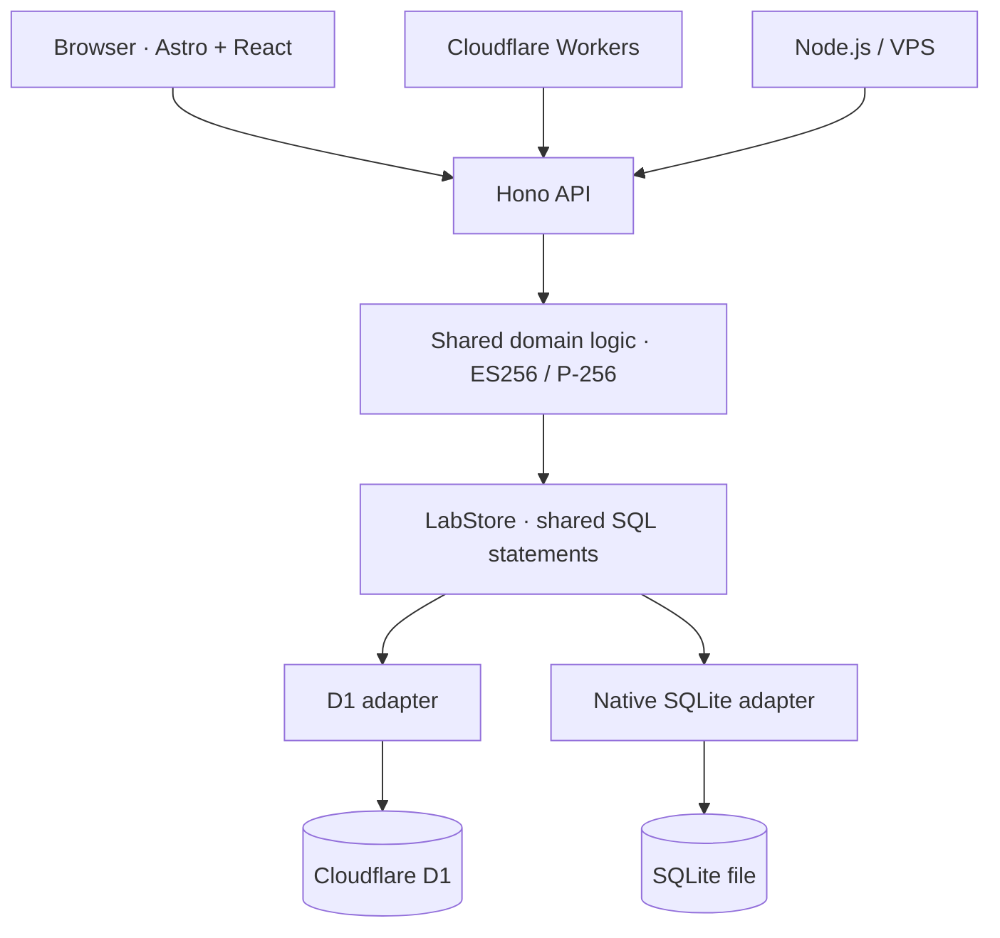
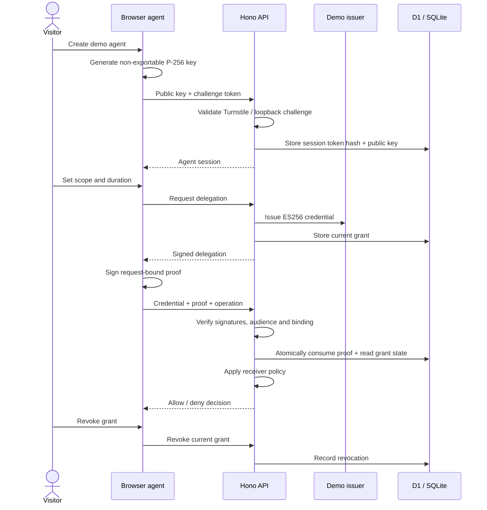

<p align="center"><a href="https://identity.rounver.com/"></a></p>
<h1 align="center">Regidi PoC</h1>
<p align="center">क्रिप्टोग्राफ़िक पहचान · सीमित प्रत्यायोजन · AI एजेंटों के लिए सत्यापन योग्य अनुमति</p>
<p align="center">
  
  
  
  
</p>
<p align="center"><a href="../README.md">English</a> · <a href="README.es.md">Español</a> · <a href="README.pt.md">Português</a> · <a href="README.de.md">Deutsch</a> · <a href="README.fr.md">Français</a> · <a href="README.it.md">Italiano</a> · <a href="README.ja.md">日本語</a> · <strong>हिन्दी</strong> · <a href="README.ar.md">العربية</a></p>
<p align="center"><a href="https://rounver.com/"></a></p>

---

## परियोजना के बारे में

Regidi PoC, **Rounver Corp. / Rounver Research** द्वारा निर्मित ओपन-सोर्स अनुसंधान डेमो है। यह सिम्युलेटेड कार्रवाइयों के माध्यम से **AI एजेंट की क्रिप्टोग्राफ़िक पहचान**, **सीमित मानव प्रत्यायोजन** और **प्राप्तकर्ता द्वारा सत्यापन** समझाता है। यह संपूर्ण Regidi-ID प्रोटोकॉल या प्रमाणित उत्पादन पहचान प्लेटफ़ॉर्म नहीं है।

**आधिकारिक इंटरैक्टिव लैब:** https://identity.rounver.com/lab/ · **Regidi-ID का परिचय:** https://rounver.com/regidi-id

## यह क्या दर्शाती है

- **ब्राउज़र में P-256 कुंजियाँ।** निजी हस्ताक्षर कुंजी गैर-निर्यात योग्य बनाई जाती है और ब्राउज़र टैब में रहती है।
- **हस्ताक्षरित प्रत्यायोजन।** डेमो जारीकर्ता सेवा, कार्रवाई, राशि और अवधि से सीमित ES256 प्रमाणपत्र जारी करता है।
- **स्वामित्व का प्रमाण।** प्रत्येक अनुरोध में प्रमाणपत्र, HTTP एंडपॉइंट और अनुरोध बॉडी से जुड़ा हस्ताक्षर होता है।
- **अनुमति संबंधी निर्णय।** नकली एयरलाइन या बैंक स्वतंत्र रूप से अपनी प्राप्तकर्ता नीति लागू करते हैं।
- **स्थिति-आधारित सुरक्षा।** प्रमाण का परमाणु उपभोग, replay रोकथाम, प्रत्यायोजन बदलना, रद्दीकरण और समाप्ति।
- **दो संगत रनटाइम।** Node.js + देशी SQLite या Cloudflare Workers + D1; API, SQL और डोमेन लॉजिक साझा हैं।

## आर्किटेक्चर



## शुरू से अंत तक प्रक्रिया



## त्वरित शुरुआत: Node.js + SQLite

**Node.js 24** आवश्यक है। Node + SQLite के लिए न्यूनतम **24.6** चाहिए; पूर्ण टूलचेन के लिए **24.22+** सुझाया जाता है।

```bash
npm ci
(umask 077
  if [ ! -e .env ]; then
    cp .env.example .env
    printf "ISSUER_PRIVATE_JWK='%s'\n" "$(npm run --silent keygen)" >> .env
  fi
)
npm run dev
```

**http://127.0.0.1:8787/lab/** खोलें। Cloudflare खाते की आवश्यकता नहीं है। स्थानीय चुनौती केवल `NODE_ENV=development`, `REGIDI_CHALLENGE=development` और `127.0.0.1` पर बंधे लिसनर के साथ काम करती है।

## Cloudflare Workers + D1 (वैकल्पिक)

```bash
npm ci
npm run db:local
npm run build:cloudflare
npm run check:cloudflare
npm test
```

स्थानीय Worker के लिए `.dev.vars.example` से `.dev.vars` बनाएँ, जारीकर्ता की अलग कुंजी उत्पन्न करें और स्थानीय होस्टनाम के लिए अधिकृत Turnstile विजेट सेट करें। बिल्ड के दौरान `PUBLIC_TURNSTILE_SITE_KEY` और उससे मेल खाता `REGIDI_PUBLIC_ORIGIN` प्रदान करें। फिर `npm run dev:cloudflare` चलाएँ। उत्पादन डिप्लॉयमेंट में Worker, खाता, D1 और लिमिटर के स्पष्ट मान आवश्यक हैं; `.env.example` तथा `cloudflare.config.ts` देखें। प्रीफ़्लाइट पहले से मौजूद लक्ष्य की माँग करता है और स्वयं इन्फ्रास्ट्रक्चर नहीं बनाता।

## कॉन्फ़िगरेशन संदर्भ

| वेरिएबल | अर्थ |
|---|---|
| `REGIDI_HOST`, `REGIDI_PORT` | Node का सुनने वाला पता और पोर्ट (डिफ़ॉल्ट `127.0.0.1:8787`) |
| `REGIDI_SQLITE_PATH` | स्थानीय SQLite फ़ाइल का पथ (डिफ़ॉल्ट `./regidi-lab.sqlite`) |
| `NODE_ENV`, `REGIDI_CHALLENGE` | स्पष्ट loopback विकास मोड; अन्यथा Turnstile |
| `REGIDI_PUBLIC_ORIGIN` | होस्टेड इंस्टॉलेशन और प्रमाण सत्यापन के लिए सार्वजनिक HTTPS मूल पता |
| `PUBLIC_TURNSTILE_SITE_KEY` | बिल्ड समय पर दिया जाने वाला सार्वजनिक विजेट की |
| `TURNSTILE_SECRET` | सर्वर-पक्ष का Turnstile सीक्रेट |
| `ISSUER_PRIVATE_JWK` | नया P-256 जारीकर्ता निजी JWK; इसे गोपनीय रखें |
| `REGIDI_ISSUER`, `REGIDI_AIR_AUDIENCE`, `REGIDI_BANK_AUDIENCE` | वैकल्पिक जारीकर्ता और श्रोता पहचानकर्ता |
| `CLOUDFLARE_ACCOUNT_ID`, `REGIDI_WORKER_NAME`, `REGIDI_D1_NAME`, `REGIDI_D1_ID`, `REGIDI_RATE_NAMESPACE` | स्पष्ट Cloudflare डिप्लॉयमेंट लक्ष्य |

## जाँच

```bash
npm run check
npm run check:cloudflare
npm run test:node
npm test
npm run audit:deps
```

`npm test` दोनों बिल्ड और स्वचालित परीक्षण चलाता है। GitHub Actions या स्वचालित प्रकाशन पाइपलाइन आवश्यक नहीं हैं।

## डिप्लॉयमेंट और सुरक्षा सीमाएँ

> **सुरक्षा का दायरा:** यह शैक्षिक PoC है। इसमें काल्पनिक पहचान और नकली बैंक/एयरलाइन संचालन हैं; यह KYC/KYB नहीं करता और प्रमाणित पहचान सेवा नहीं है। सार्वजनिक इंस्टॉलेशन में HTTPS और Cloudflare Turnstile आवश्यक हैं। स्थानीय loopback विकास में स्पष्ट रूप से सक्षम की गई एकबारगी चुनौती उपयोग होती है।

- **रिवर्स प्रॉक्सी:** Node, फ़ॉरवर्ड किए गए IP हेडर के बजाय TCP peer पते से IP सीमा तय करता है। एक ही प्रॉक्सी के उपयोगकर्ता सीमा साझा कर सकते हैं और HTTP 429 पा सकते हैं।
- **होस्टेड Node:** प्रॉक्सी पर HTTPS, `REGIDI_PUBLIC_ORIGIN`, उत्पादन Turnstile क्रेडेंशियल और लिखने योग्य स्थायी SQLite पथ सेट करें।
- **क्रिप्टोग्राफ़ी:** जारीकर्ता कुंजियाँ सर्वर पर रहती हैं। `.env`, `.dev.vars`, डेटाबेस या निजी JWK को कभी कमिट न करें।
- **सत्यापन:** वास्तविक होस्टेड Turnstile एकीकरण का ऑपरेटर द्वारा अलग परीक्षण आवश्यक है। स्थानीय स्वचालित परीक्षण Siteverify का अनुकरण करते हैं।

## स्वतंत्र इंस्टॉलेशन की नीतियाँ

शामिल गोपनीयता नीति, उपयोग की शर्तें और सुरक्षा नीति **Rounver Corp. द्वारा संचालित आधिकारिक इंस्टॉलेशन** पर लागू होती हैं। स्वतंत्र ऑपरेटर को अपनी पहचान, इन्फ्रास्ट्रक्चर, डेटा प्रसंस्करण और कानूनी जिम्मेदारियों के अनुसार इन्हें बदलना होगा।

## रखरखाव और योगदान

मूल सॉफ़्टवेयर और तकनीकी दस्तावेज़ [MIT](../LICENSE) के तहत हैं। आधिकारिक परियोजना का रखरखाव केवल Rounver Corp. करती है। **बाहरी pull requests स्वीकार नहीं हैं**; समस्याएँ [Issues](https://github.com/rounverr/regidi-poc/issues) पर बताई जा सकती हैं। MIT अपनी शर्तों के तहत forks और पुनः उपयोग की अनुमति देता है, बिना मुख्य परियोजना पर बदलाव अपनाने की बाध्यता के।

मूल लोगो और ग्राफ़िक्स **इस PoC के साथ श्रेय देकर** [तृतीय-पक्ष और ब्रांड नोटिस](../THIRD_PARTY_NOTICES.md) के अनुसार बाँटे जा सकते हैं। फ़ॉन्ट और निर्भरताओं के अलग लाइसेंस लागू रहते हैं।

## श्रेय

**Rounver Corp.** ने **Rounver Research** के माध्यम से इसे बनाया और इसका रखरखाव करती है। [Rounver](https://rounver.com/) · [Regidi-ID](https://rounver.com/regidi-id) · [Official Lab](https://identity.rounver.com/).

**Autora:** Sil R. Galeano
