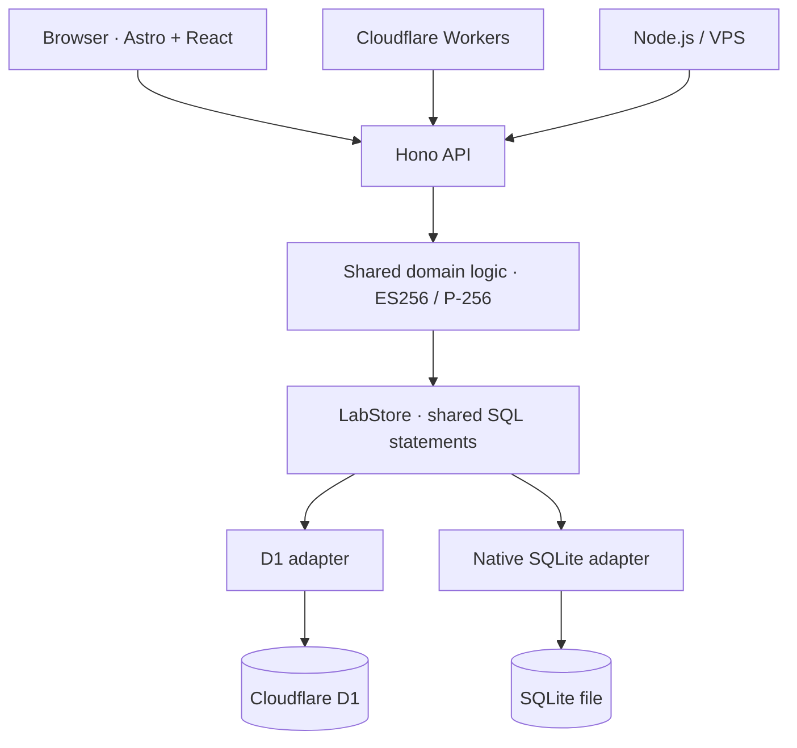
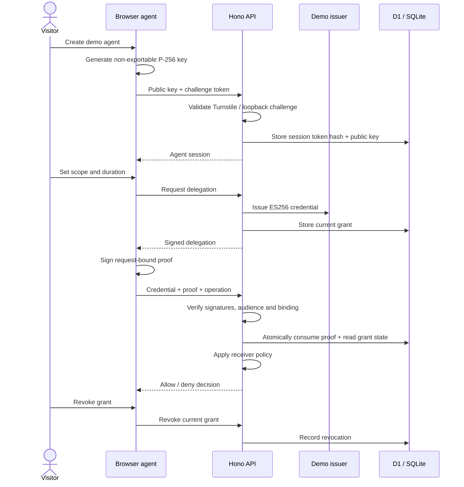

<p align="center"><a href="https://identity.rounver.com/"></a></p>
<h1 align="center">Regidi PoC</h1>
<p align="center">Identità crittografica · Delega limitata · Autorizzazione verificabile per agenti IA</p>
<p align="center">
  
  
  
  
</p>
<p align="center"><a href="../README.md">English</a> · <a href="README.es.md">Español</a> · <a href="README.pt.md">Português</a> · <a href="README.de.md">Deutsch</a> · <a href="README.fr.md">Français</a> · <strong>Italiano</strong> · <a href="README.ja.md">日本語</a> · <a href="README.hi.md">हिन्दी</a> · <a href="README.ar.md">العربية</a></p>
<p align="center"><a href="https://rounver.com/"></a></p>

---

## <picture></picture> Informazioni sul progetto

Regidi PoC è una dimostrazione di ricerca open source creata da **Rounver Corp. / Rounver Research**. Esplora **l’identità crittografica degli agenti IA**, la **delega umana con ambito limitato** e la **verifica da parte del destinatario** usando operazioni simulate. Non è l’intero protocollo Regidi-ID né una piattaforma di identità certificata per la produzione.

**Laboratorio interattivo ufficiale:** https://identity.rounver.com/lab/ · **Panoramica Regidi-ID:** https://rounver.com/regidi-id · **[White Paper tecnico (DOI)](https://doi.org/10.5281/zenodo.24469990)**

## <picture></picture> Cosa dimostra

- **Chiavi P-256 nel browser.** La chiave privata di firma viene generata come non esportabile e rimane nella scheda.
- **Delega firmata.** Un emittente dimostrativo rilascia credenziali ES256 limitate per servizio, operazione, importo e durata.
- **Prova di possesso.** Ogni richiesta include una firma vincolata alla credenziale, all’endpoint HTTP e al corpo della richiesta.
- **Decisioni di autorizzazione.** Una compagnia aerea o una banca simulate applicano autonomamente le proprie regole.
- **Sicurezza con stato.** Consumo atomico delle prove, prevenzione dei replay, sostituzione delle deleghe, revoca e scadenza.
- **Due runtime compatibili.** Node.js con SQLite nativo o Cloudflare Workers con D1, con API, SQL e logica di dominio condivisi.

## <picture></picture> Architettura



## <picture></picture> Flusso completo



## <picture></picture> Avvio rapido: Node.js + SQLite

Richiede **Node.js 24**. Node + SQLite necessita almeno della versione **24.6**; è consigliata la **24.22+** per l’intera toolchain.

```bash
npm ci
(umask 077
  if [ ! -e .env ]; then
    cp .env.example .env
    printf "ISSUER_PRIVATE_JWK='%s'\n" "$(npm run --silent keygen)" >> .env
  fi
)
npm run dev
```

Apri **http://127.0.0.1:8787/lab/**. Non serve un account Cloudflare. La challenge locale funziona solo con `NODE_ENV=development`, `REGIDI_CHALLENGE=development` e il listener su `127.0.0.1`.

## <picture></picture> Cloudflare Workers + D1 (opzionale)

```bash
npm ci
npm run db:local
npm run build:cloudflare
npm run check:cloudflare
npm test
```

Per il Worker locale, configura `.dev.vars` partendo da `.dev.vars.example`, genera una chiave separata per l’emittente e configura un widget Turnstile autorizzato per l’hostname locale. Fornisci `PUBLIC_TURNSTILE_SITE_KEY` durante il build e il relativo `REGIDI_PUBLIC_ORIGIN`. Poi esegui `npm run dev:cloudflare`. In produzione servono identificativi espliciti per Worker, account, D1 e limitatore; consulta `.env.example` e `cloudflare.config.ts`. Il preflight richiede risorse preesistenti e non crea infrastruttura.

## <picture></picture> Riferimento di configurazione

| Variabile | Significato |
|---|---|
| `REGIDI_HOST`, `REGIDI_PORT` | Indirizzo e porta del listener Node (predefinito `127.0.0.1:8787`) |
| `REGIDI_SQLITE_PATH` | Percorso del file SQLite (predefinito `./regidi-lab.sqlite`) |
| `NODE_ENV`, `REGIDI_CHALLENGE` | Modalità di sviluppo loopback esplicita; altrimenti Turnstile |
| `REGIDI_PUBLIC_ORIGIN` | Origine HTTPS pubblica per installazioni ospitate e verifica delle prove |
| `PUBLIC_TURNSTILE_SITE_KEY` | Chiave pubblica del widget fornita in fase di build |
| `TURNSTILE_SECRET` | Segreto Turnstile sul server |
| `ISSUER_PRIVATE_JWK` | JWK privata P-256 dell’emittente generata per l’installazione; mantenerla segreta |
| `REGIDI_ISSUER`, `REGIDI_AIR_AUDIENCE`, `REGIDI_BANK_AUDIENCE` | Identificativi opzionali di emittente e destinatari |
| `CLOUDFLARE_ACCOUNT_ID`, `REGIDI_WORKER_NAME`, `REGIDI_D1_NAME`, `REGIDI_D1_ID`, `REGIDI_RATE_NAMESPACE` | Destinazioni esplicite per la distribuzione Cloudflare |

## <picture></picture> Verifiche

```bash
npm run check
npm run check:cloudflare
npm run test:node
npm test
npm run audit:deps
```

`npm test` esegue entrambi i build e tutte le suite automatizzate. GitHub Actions e pipeline automatiche di pubblicazione non sono necessari.

## <picture></picture> Distribuzione e limiti di sicurezza

> **Ambito di sicurezza:** Questo PoC è didattico. Usa identità fittizie e operazioni bancarie e aeree simulate, non esegue KYC/KYB e non è un servizio di identità certificato. Le istanze pubbliche richiedono HTTPS e Cloudflare Turnstile. Lo sviluppo loopback usa una challenge monouso esplicitamente abilitata.

- **Reverse proxy:** Node determina i limiti IP dall’indirizzo TCP peer, non dagli header inoltrati. Utenti dietro lo stesso proxy possono condividere un limite e ricevere HTTP 429.
- **Node ospitato:** Configura HTTPS nel proxy, `REGIDI_PUBLIC_ORIGIN`, le credenziali Turnstile di produzione e un percorso SQLite persistente scrivibile.
- **Crittografia:** Le chiavi dell’emittente restano sul server. Non pubblicare `.env`, `.dev.vars`, database né JWK private generate.
- **Verifica:** L’integrazione con un widget Turnstile reale richiede test specifici per ogni operatore. I test locali simulano Siteverify.

## <picture></picture> Informative per installazioni indipendenti

Le informative su privacy, termini e sicurezza incluse si applicano alla **installazione ufficiale gestita da Rounver Corp.** Gli operatori indipendenti devono adattarle alla propria identità, infrastruttura, gestione dei dati e agli obblighi legali.

## <picture></picture> Manutenzione e contributi

Il software originale e la documentazione tecnica sono sotto licenza [MIT](../LICENSE). Rounver Corp. mantiene esclusivamente il progetto ufficiale. **Non si accettano pull request esterne**; si possono segnalare problemi nelle [Issues](https://github.com/rounverr/regidi-poc/issues). MIT consente fork e riutilizzo senza obbligo di integrare le modifiche.

I loghi e i materiali grafici originali possono essere redistribuiti **con il PoC e relativa attribuzione**, secondo gli [avvisi su terze parti e marchi](../THIRD_PARTY_NOTICES.md). Font e dipendenze conservano le rispettive licenze.

## <picture></picture> Crediti

Creato e mantenuto da **Rounver Corp.** attraverso **Rounver Research**. [Rounver](https://rounver.com/) · [Regidi-ID](https://rounver.com/regidi-id) · [Official Lab](https://identity.rounver.com/).

**Autora:** Sil R. Galeano
