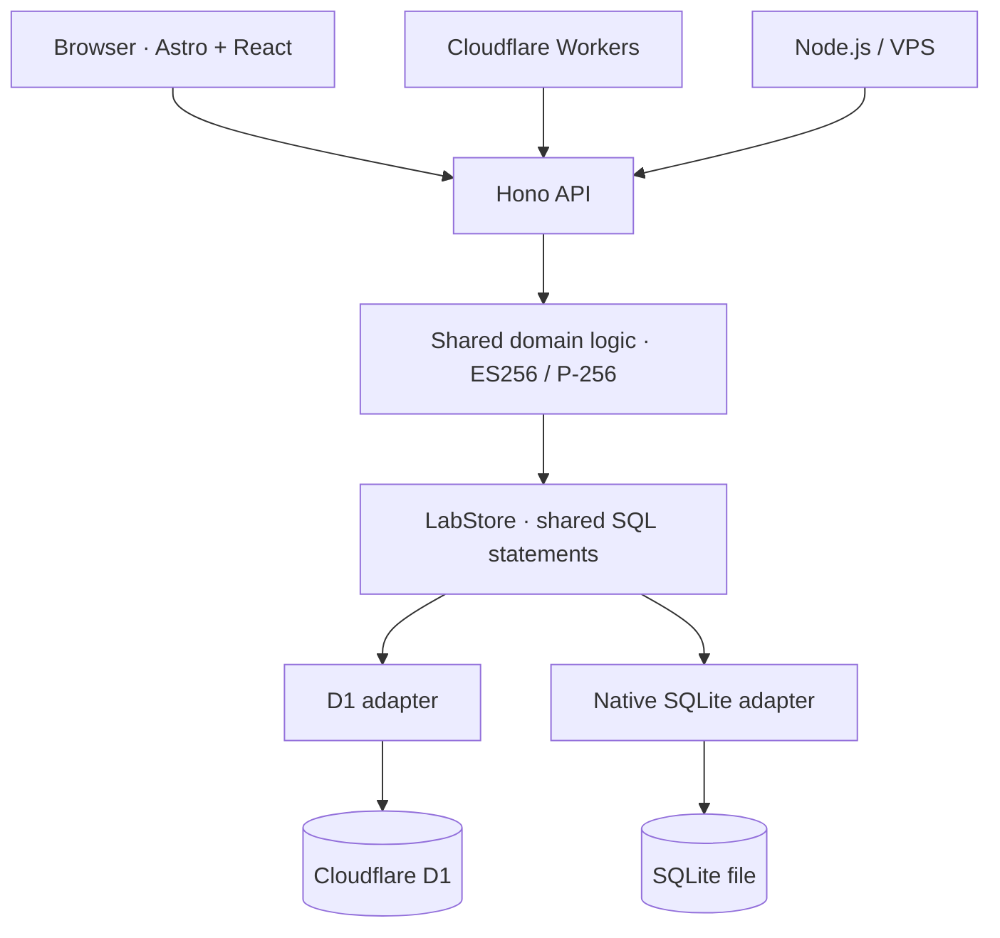
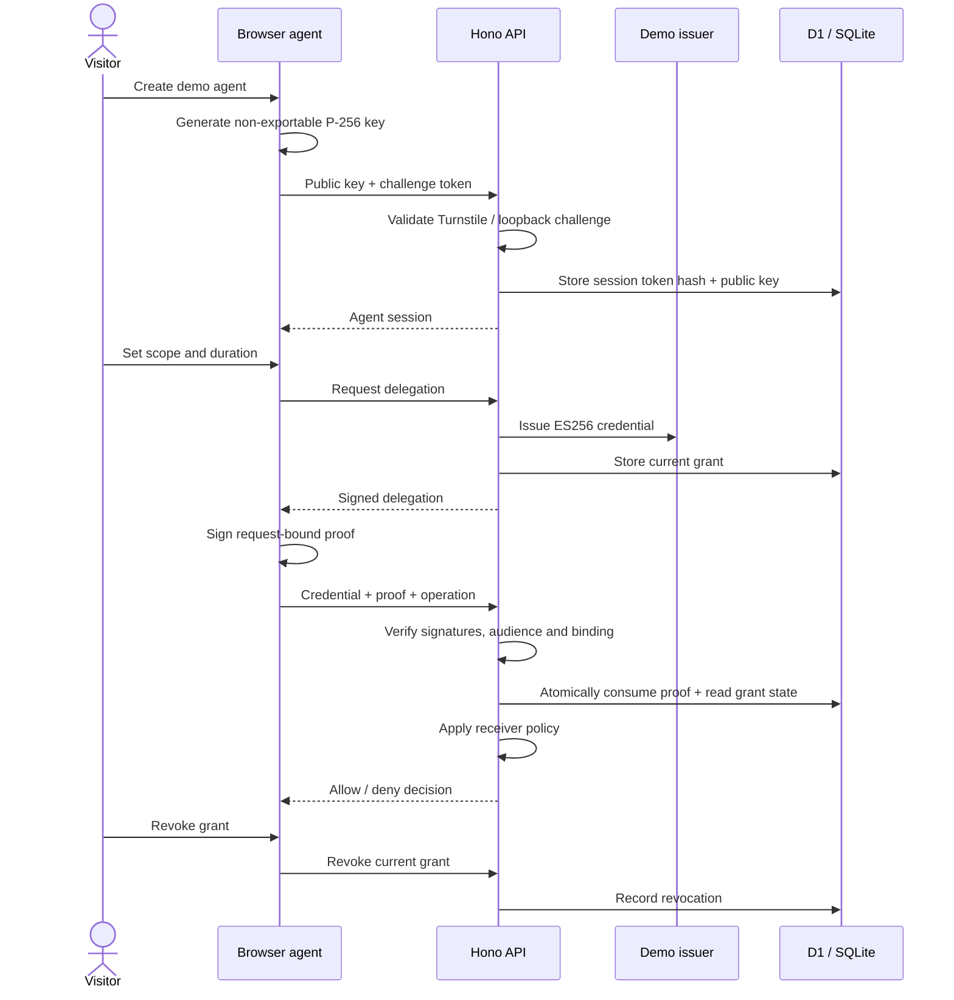

<p align="center"><a href="https://identity.rounver.com/"></a></p>
<h1 align="center">Regidi PoC</h1>
<p align="center">暗号学的ID · 範囲を限定した権限委譲 · AIエージェントの検証可能な認可</p>
<p align="center">
  
  
  
  
</p>
<p align="center"><a href="../README.md">English</a> · <a href="README.es.md">Español</a> · <a href="README.pt.md">Português</a> · <a href="README.de.md">Deutsch</a> · <a href="README.fr.md">Français</a> · <a href="README.it.md">Italiano</a> · <strong>日本語</strong> · <a href="README.hi.md">हिन्दी</a> · <a href="README.ar.md">العربية</a></p>
<p align="center"><a href="https://rounver.com/"></a></p>

---

## <picture></picture> プロジェクト概要

Regidi PoCは**Rounver Corp. / Rounver Research**によるオープンソースの研究用デモです。模擬操作を通じて、**AIエージェントの暗号学的ID**、**人による限定的な権限委譲**、**受信側での検証**を示します。Regidi-IDプロトコル全体の実装ではなく、認証済みの本番用ID基盤でもありません。

**公式インタラクティブラボ:** https://identity.rounver.com/lab/ · **Regidi-ID概要:** https://rounver.com/regidi-id · **[技術ホワイトペーパー（DOI）](https://doi.org/10.5281/zenodo.24469990)**

## <picture></picture> デモで示す機能

- **ブラウザー内のP-256鍵。** 署名用秘密鍵はエクスポート不可として生成され、ブラウザーのタブに保持されます。
- **署名付き権限委譲。** デモ発行者がサービス・操作・金額・期間で制限されたES256資格情報を発行します。
- **鍵の所有証明。** 各リクエストは資格情報、HTTPエンドポイント、リクエスト本文に結びついた署名を持ちます。
- **認可判断。** 模擬航空会社または銀行が、それぞれ独立した受信側ポリシーを適用します。
- **状態を伴うセキュリティ。** 証明のアトミックな消費、リプレイ防止、委譲の置換、失効、有効期限を扱います。
- **互換性のある2つの実行環境。** Node.js + ネイティブSQLite、またはCloudflare Workers + D1で、API・SQL・ドメインロジックを共有します。

## <picture></picture> アーキテクチャ



## <picture></picture> エンドツーエンドの流れ



## <picture></picture> クイックスタート: Node.js + SQLite

**Node.js 24**が必要です。Node + SQLiteは最低**24.6**、すべてのツールを使う場合は**24.22以上**を推奨します。

```bash
npm ci
(umask 077
  if [ ! -e .env ]; then
    cp .env.example .env
    printf "ISSUER_PRIVATE_JWK='%s'\n" "$(npm run --silent keygen)" >> .env
  fi
)
npm run dev
```

**http://127.0.0.1:8787/lab/** を開いてください。Cloudflareアカウントは不要です。ローカルチャレンジは`NODE_ENV=development`、`REGIDI_CHALLENGE=development`を設定し、リスナーを`127.0.0.1`にバインドした場合のみ動作します。

## <picture></picture> Cloudflare Workers + D1（任意）

```bash
npm ci
npm run db:local
npm run build:cloudflare
npm run check:cloudflare
npm test
```

Workerをローカルで操作するには、`.dev.vars.example`から`.dev.vars`を作成し、発行者用の別の鍵を生成し、ローカルホスト名に許可されたTurnstileウィジェットを設定します。ビルド時に`PUBLIC_TURNSTILE_SITE_KEY`と一致する`REGIDI_PUBLIC_ORIGIN`を渡し、`npm run dev:cloudflare`を実行してください。本番環境ではWorker、アカウント、D1、レートリミッターの明示的な設定が必要です。`.env.example`と`cloudflare.config.ts`を参照してください。事前検査は既存のデプロイ先を要求し、新しいインフラを自動作成しません。

## <picture></picture> 設定項目一覧

| 変数 | 意味 |
|---|---|
| `REGIDI_HOST`, `REGIDI_PORT` | Nodeの待受アドレスとポート（既定`127.0.0.1:8787`） |
| `REGIDI_SQLITE_PATH` | ローカルSQLiteファイルのパス（既定`./regidi-lab.sqlite`） |
| `NODE_ENV`, `REGIDI_CHALLENGE` | 明示的なループバック開発モード。それ以外はTurnstile |
| `REGIDI_PUBLIC_ORIGIN` | ホストされた環境と証明検証のための公開HTTPSオリジン |
| `PUBLIC_TURNSTILE_SITE_KEY` | ビルド時に指定する公開ウィジェットキー |
| `TURNSTILE_SECRET` | サーバー側のTurnstileシークレット |
| `ISSUER_PRIVATE_JWK` | 新規生成した発行者のP-256秘密JWK。機密として管理 |
| `REGIDI_ISSUER`, `REGIDI_AIR_AUDIENCE`, `REGIDI_BANK_AUDIENCE` | 任意の発行者IDと受信者識別子 |
| `CLOUDFLARE_ACCOUNT_ID`, `REGIDI_WORKER_NAME`, `REGIDI_D1_NAME`, `REGIDI_D1_ID`, `REGIDI_RATE_NAMESPACE` | 明示的なCloudflareデプロイ先 |

## <picture></picture> 検証コマンド

```bash
npm run check
npm run check:cloudflare
npm run test:node
npm test
npm run audit:deps
```

`npm test`は両方のビルドと自動テストを実行します。GitHub Actionsや自動公開パイプラインは必須ではありません。

## <picture></picture> デプロイとセキュリティ上の制約

> **セキュリティの対象範囲:** これは教育用PoCです。架空のIDと模擬的な銀行・航空会社の操作を使用し、KYC/KYBは実施しません。認証済みのIDサービスとして使用できません。公開環境にはHTTPSとCloudflare Turnstileが必要です。ローカル開発では明示的に有効化された使い捨てチャレンジを使用します。

- **リバースプロキシ:** Nodeは転送されたIPヘッダーではなくTCP接続元のアドレスを使用してIP制限を計算します。同じプロキシの利用者が制限を共有し、HTTP 429になる場合があります。
- **ホストされたNode:** プロキシでHTTPS、`REGIDI_PUBLIC_ORIGIN`、本番用Turnstile認証情報、書き込み可能な永続SQLiteパスを設定してください。
- **暗号処理:** 発行者の鍵はサーバー側に保持されます。`.env`、`.dev.vars`、データベース、生成された秘密JWKをコミットしないでください。
- **検証:** 本番のTurnstile連携には運用者ごとの検証が必要です。ローカルの自動テストはSiteverifyを模擬します。

## <picture></picture> 独立運用時のポリシー

同梱のプライバシー・利用規約・セキュリティポリシーは、**Rounver Corp.が運用する公式環境**に適用されます。独立運用者は、運営者の情報、インフラ、データ処理、法的義務に合わせて変更する必要があります。

## <picture></picture> 保守とコントリビューション

オリジナルのソフトウェアと技術文書は[MIT](../LICENSE)ライセンスです。公式プロジェクトはRounver Corp.が単独で保守します。**外部のプルリクエストは受け付けません**。不具合は[Issues](https://github.com/rounverr/regidi-poc/issues)で報告できます。MITは条件に従ったフォークと再利用を認めますが、公式側に変更の採用義務はありません。

オリジナルのロゴと画像は、[サードパーティ・ブランド表記](../THIRD_PARTY_NOTICES.md)に従い**このPoCとともに帰属表示付きで**再配布できます。フォントと依存ライブラリにはそれぞれのライセンスが適用されます。

## <picture></picture> クレジット

**Rounver Corp.**が**Rounver Research**を通じて開発・保守しています。 [Rounver](https://rounver.com/) · [Regidi-ID](https://rounver.com/regidi-id) · [Official Lab](https://identity.rounver.com/).

**Autora:** Sil R. Galeano
