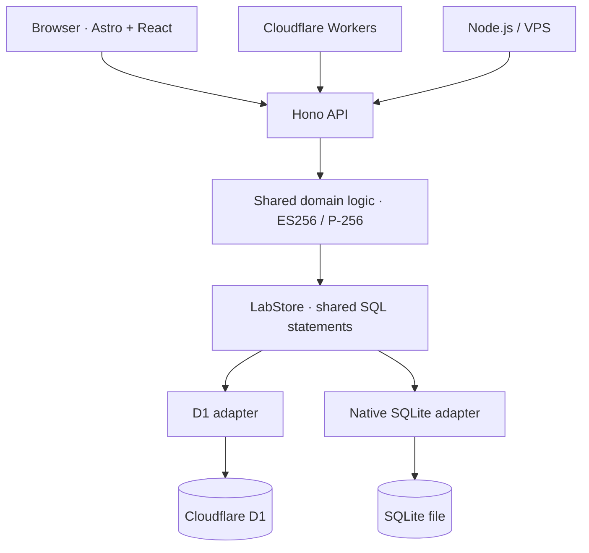
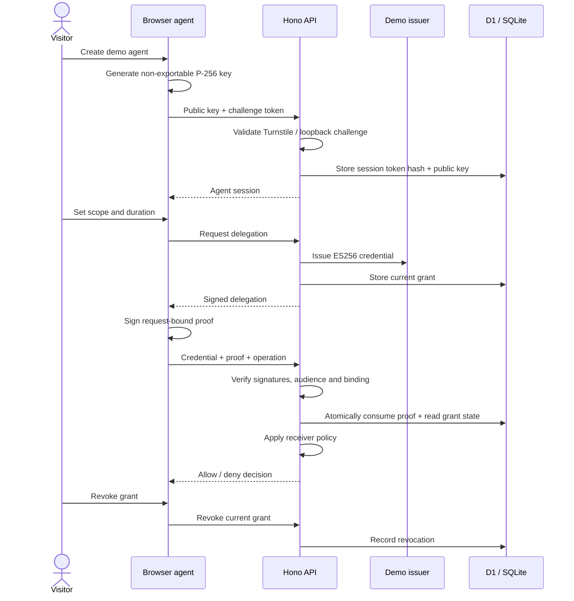

<p align="center"><a href="https://identity.rounver.com/"></a></p>
<h1 align="center">Regidi PoC</h1>
<p align="center">Identidade criptográfica · Delegação limitada · Autorização verificável para agentes de IA</p>
<p align="center">
  
  
  
  
</p>
<p align="center"><a href="../README.md">English</a> · <a href="README.es.md">Español</a> · <strong>Português</strong> · <a href="README.de.md">Deutsch</a> · <a href="README.fr.md">Français</a> · <a href="README.it.md">Italiano</a> · <a href="README.ja.md">日本語</a> · <a href="README.hi.md">हिन्दी</a> · <a href="README.ar.md">العربية</a></p>
<p align="center"><a href="https://rounver.com/"></a></p>

---

## Sobre o projeto

Regidi PoC é uma demonstração de pesquisa open source criada pela **Rounver Corp. / Rounver Research**. Explora a **identidade criptográfica de agentes de IA**, a **delegação humana com escopo limitado** e a **verificação pelo serviço receptor** usando operações simuladas. Não é o protocolo Regidi-ID completo nem uma plataforma de identidade certificada para produção.

**Laboratório interativo oficial:** https://identity.rounver.com/lab/ · **Visão geral do Regidi-ID:** https://rounver.com/regidi-id · **[White Paper técnico (DOI)](https://doi.org/10.5281/zenodo.24469990)**

## O que demonstra

- **Chaves P-256 no navegador.** A chave privada de assinatura é gerada como não exportável e permanece na aba.
- **Delegação assinada.** Um emissor de demonstração fornece credenciais ES256 limitadas por serviço, operação, valor e duração.
- **Prova de posse.** Cada solicitação inclui uma assinatura vinculada à credencial, ao endpoint HTTP e ao corpo da solicitação.
- **Decisões de autorização.** Uma companhia aérea ou um banco simulados aplicam independentemente suas políticas.
- **Segurança com estado.** Consumo atômico de provas, prevenção de replay, substituição de delegação, revogação e expiração.
- **Dois runtimes compatíveis.** Node.js com SQLite nativo ou Cloudflare Workers com D1, compartilhando API, SQL e lógica de domínio.

## Arquitetura



## Fluxo completo



## Início rápido: Node.js + SQLite

Requer **Node.js 24**. Node + SQLite exige pelo menos **24.6**; recomenda-se **24.22+** para todas as ferramentas.

```bash
npm ci
(umask 077
  if [ ! -e .env ]; then
    cp .env.example .env
    printf "ISSUER_PRIVATE_JWK='%s'\n" "$(npm run --silent keygen)" >> .env
  fi
)
npm run dev
```

Acesse **http://127.0.0.1:8787/lab/**. Nenhuma conta Cloudflare é necessária. O desafio local só funciona com `NODE_ENV=development`, `REGIDI_CHALLENGE=development` e o servidor vinculado a `127.0.0.1`.

## Cloudflare Workers + D1 (opcional)

```bash
npm ci
npm run db:local
npm run build:cloudflare
npm run check:cloudflare
npm test
```

Para usar o Worker local, configure `.dev.vars` a partir de `.dev.vars.example`, gere uma chave diferente para o emissor e configure um widget Turnstile autorizado para o host local. Forneça `PUBLIC_TURNSTILE_SITE_KEY` durante o build e o `REGIDI_PUBLIC_ORIGIN` correspondente. Execute `npm run dev:cloudflare`. Implantação em produção exige Worker, conta, D1 e limitador explicitamente definidos; consulte `.env.example` e `cloudflare.config.ts`. O preflight requer um destino existente e não provisiona infraestrutura.

## Referência de configuração

| Variável | Descrição |
|---|---|
| `REGIDI_HOST`, `REGIDI_PORT` | Endereço e porta do servidor Node (padrão `127.0.0.1:8787`) |
| `REGIDI_SQLITE_PATH` | Caminho do arquivo SQLite (padrão `./regidi-lab.sqlite`) |
| `NODE_ENV`, `REGIDI_CHALLENGE` | Modo explícito de desenvolvimento em loopback; caso contrário, Turnstile |
| `REGIDI_PUBLIC_ORIGIN` | Origem HTTPS pública para instalações hospedadas e verificação de provas |
| `PUBLIC_TURNSTILE_SITE_KEY` | Chave pública do widget definida no build |
| `TURNSTILE_SECRET` | Segredo Turnstile no servidor |
| `ISSUER_PRIVATE_JWK` | JWK privada P-256 recém-gerada do emissor; manter em segredo |
| `REGIDI_ISSUER`, `REGIDI_AIR_AUDIENCE`, `REGIDI_BANK_AUDIENCE` | Identificadores opcionais do emissor e das audiências |
| `CLOUDFLARE_ACCOUNT_ID`, `REGIDI_WORKER_NAME`, `REGIDI_D1_NAME`, `REGIDI_D1_ID`, `REGIDI_RATE_NAMESPACE` | Destinos explícitos de implantação no Cloudflare |

## Verificações

```bash
npm run check
npm run check:cloudflare
npm run test:node
npm test
npm run audit:deps
```

`npm test` executa ambos os builds e as suítes automatizadas. GitHub Actions e pipelines automáticos de publicação não são necessários.

## Implantação e limitações de segurança

> **Escopo de segurança:** Este é um PoC educacional. Usa identidades fictícias e operações bancárias e aéreas simuladas; não realiza KYC/KYB e não deve ser tratado como serviço de identidade certificado. Instalações públicas exigem HTTPS e Cloudflare Turnstile. O desenvolvimento loopback utiliza um desafio de uso único ativado explicitamente.

- **Proxies reversos:** Node deriva o limite de IP do par TCP, não de cabeçalhos encaminhados. Vários clientes por proxy podem compartilhar o limite e receber HTTP 429.
- **Node hospedado:** Configure HTTPS no proxy, `REGIDI_PUBLIC_ORIGIN`, credenciais Turnstile de produção e um caminho SQLite persistente e gravável.
- **Criptografia:** Chaves do emissor ficam no servidor. Nunca faça commit de `.env`, `.dev.vars`, arquivos de banco de dados ou JWKs privadas.
- **Verificação:** A integração real com Turnstile deve ser validada pelo operador. Os testes locais simulam Siteverify.

## Políticas para instalações independentes

As políticas de privacidade, termos e segurança incluídas aplicam-se à **instalação oficial operada pela Rounver Corp.** Operadores independentes devem adaptá-las à sua identidade, infraestrutura, processamento de dados e obrigações legais.

## Manutenção e contribuições

O software original e a documentação técnica estão sob [MIT](../LICENSE). A Rounver Corp. mantém exclusivamente o projeto oficial. **Pull requests externos não são aceitos**; problemas podem ser relatados via [Issues](https://github.com/rounverr/regidi-poc/issues). A licença MIT permite forks e reutilização sem obrigar a integração de alterações.

Logos e gráficos originais podem ser redistribuídos **junto com este PoC e com atribuição**, conforme os [avisos sobre marcas e terceiros](../THIRD_PARTY_NOTICES.md). Fontes e dependências mantêm suas licenças.

## Créditos

Criado e mantido pela **Rounver Corp.**, através da **Rounver Research**. [Rounver](https://rounver.com/) · [Regidi-ID](https://rounver.com/regidi-id) · [Official Lab](https://identity.rounver.com/).

**Autora:** Sil R. Galeano
